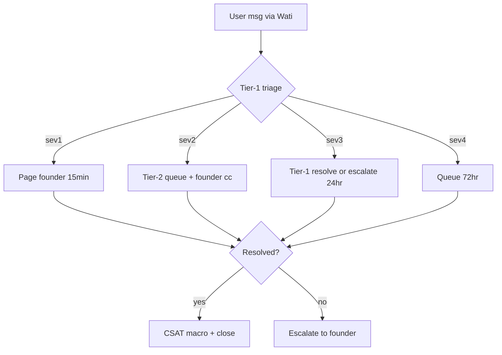

# R-Q2-CS-004 — Tier-2 Support Escalation Flow + On-Call Rotation

## MISSION
Ship customer support infrastructure artifacts agents CAN produce. Item `status: shipped` but `shipped_at: null`, KPI `tier2_escalation_live.current: 0`. Contradiction — verify actual state first. If artifacts already exist in `docs/agent-reports/cs/`, report findings and skip. If not, ship them.

CS briefing: most support KPIs return "no manual value". This item operationalizes the placeholder success_criteria into shipped artifacts.

## PRE-FLIGHT (read-only, do first, NO writes)
1. Read `docs/roadmap/_index.json` — find entry `R-Q2-CS-004`, capture full scope + KPI definition
2. Read `docs/roadmap/items/Q2/cs/004-tier-2-support-escalation-flow-sev-levels-on-call-.md` — capture success_criteria + kpi.query
3. `ls docs/agent-reports/cs/ 2>/dev/null` — list existing artifacts. If sev-matrix.md + oncall-rotation.md + escalation-flow.md already exist → report `ALREADY-SHIPPED` in final summary, skip creation, still update roadmap KPI if stale.
4. Read `docs/operations/on-call.md` if exists (capture current on-call state, may override template)
5. Read `docs/legal/refund-policy.md` if exists (capture refund policy — must align playbook)
6. Read `docs/agent-reports/cs/` index if exists — avoid duplication with R-Q1-CS-003 / R-Q2-CS-001 / R-Q2-CS-002 (already queued)

## SHIP ARTIFACTS
All artifacts → `docs/agent-reports/cs/`. Each `.md` starts with YAML frontmatter:

```yaml
---
artifact: <name>
category: cs
item: R-Q2-CS-004
languages: [hi, en]
created_at: <ISO now>
agent_produced: true
founder_review_required: true
review_status: draft
---
```

### File 1: `docs/agent-reports/cs/sev-matrix.md`
Sev1–Sev4 definition matrix:
- **sev1 (critical)**: payment failure, data loss, app down, security breach → 15min response SLA, founder paged immediately
- **sev2 (high)**: feature broken for paying user, booking failure, donation stuck → 2hr response, tier-2 assigned, founder cc
- **sev3 (medium)**: feature broken for free user, UI broken with workaround → 24hr response, tier-1 + escalate if unresolved
- **sev4 (low)**: cosmetic, FAQ gap, general inquiry → 72hr response, queue
Include: SLA table (sev | response | resolution | who-pages | channel), escalation path (tier-1 Wati → tier-2 agent+founder → founder), auto-close rules (sev4 7d no-reply → close), severity-downgrade rules.

### File 2: `docs/agent-reports/cs/oncall-rotation.md`
Weekly on-call rotation template:
- Week starts Monday 09:00 IST, ends Sunday 18:00 IST
- Primary on-call + backup on-call roles
- Handoff protocol: Slack `#cs-oncall` channel, 15min written briefing, open incidents list
- Escalation: if primary unresponsive 15min → page backup; backup unresponsive 15min → page founder
- **Founder action required**: confirm roster (currently founder-only until team grows ≥2 members)
- Include empty roster table: `| week_start | primary | backup |`

### File 3: `docs/agent-reports/cs/escalation-flow.md`
Escalation flowchart (mermaid + text):

Include decision rules: refund >₹500 → founder approve; churn risk signal → founder loop; sev1 → page founder regardless; tier-1 stuck >24hr → auto-escalate tier-2.

### File 4: `docs/agent-reports/cs/macro-templates.md`
Multilingual macro templates. Each macro block:
```yaml
macro_id: <category>-<lang>
language: hi|en|ta|te|bn|mr
trigger: <regex or keyword>
severity: sev1|sev2|sev3|sev4
body: |
  <message>
```
Categories (ship hi + en minimum): greeting, payment-failure, refund-request, churn-risk, sev1-ack, sev2-ack, sev3-ack, resolution-csat, temple-add-faq, pandit-booking-faq.
Attempt ta/te/bn/mr for greeting + payment-failure + refund-request only — mark `review_status: native-speaker-required`.
**Founder action required**: native-speaker review for non-hi/en before going live.

### File 5: `docs/agent-reports/cs/helpcenter-drafts.md`
Draft help center articles (300–500 words each):
1. "How to add a temple to Bhaktisetu" (en + hi)
2. "Refund policy and how to request" (en + hi)
3. "Why my payment failed" (en + hi)
4. "How to book a pandit" (en + hi)
5. "Multi-language support availability" (en + hi)
Each article: `title`, `slug`, `language`, `body`, `last_reviewed`.
Mark `founder_review_required: true` for legal-adjacent (refund, payment).

### File 6: `docs/agent-reports/cs/whatsapp-flow.md`
WhatsApp support flow documentation:
- Inbound (Wati) → auto-ack macro (sev4 greeting) → tier-1 triage
- Sev1 → page founder via Wati Meta template (template name `sev1_founder_page`)
- Sev2 → tier-2 queue (Slack `#cs-tier2`, founder + agent)
- Sev3/4 → tier-1 resolve or queue
- Resolution → CSAT macro (NPS 1-10) → close
- Business hours: 09:00–21:00 IST; after-hours → auto-ack + queue
**Founder action required**: Wati Meta template approval (sev1 page template + CSAT template).

### File 7: `docs/agent-reports/cs/refund-churn-playbook.md`
Refund + churn response playbooks:
**Refund**: eligibility check (within 7d, service not rendered) → amount threshold (<₹500 tier-2 auto, ₹500–₹5000 founder, >₹5000 founder+co-founder) → approval matrix → refund macro → close.
**Churn**: detection signals (no-login 30d, payment fail 3x, complaint sev1/2) → retention macro (discount or pandit call-back) → founder loop if MRR >₹1000 or lifetime >₹5000.
Decision tree (mermaid), macro references (link to macro-templates.md IDs), escalation rules.

## TDD VALIDATION (write test FIRST, before artifacts)
Create `docs/agent-reports/cs/_validate.ps1`:
```powershell
# Validates all CS artifacts have required frontmatter + content
$root = "docs/agent-reports/cs"
$files = @("sev-matrix.md","oncall-rotation.md","escalation-flow.md","macro-templates.md","helpcenter-drafts.md","whatsapp-flow.md","refund-churn-playbook.md")
foreach ($f in $files) {
  $p = Join-Path $root $f
  if (-not (Test-Path $p)) { Write-Error "MISSING: $p"; exit 1 }
  $c = Get-Content $p -Raw
  if ($c -notmatch "^---\nartifact:") { Write-Error "BAD-FRONTMATTER: $f"; exit 1 }
}
# Sev matrix must have 4 levels
$sev = Get-Content (Join-Path $root "sev-matrix.md") -Raw
foreach ($s in @("sev1","sev2","sev3","sev4")) {
  if ($sev -notmatch $s) { Write-Error "MISSING-SEV: $s"; exit 1 }
}
# Mermaid blocks parse (basic — count begin/end balance)
$esc = Get-Content (Join-Path $root "escalation-flow.md") -Raw
$begin = ([regex]::Matches($esc,"```mermaid")).Count
$end = ([regex]::Matches($esc,"```$")).Count
if ($begin -eq 0) { Write-Error "NO-MERMAID"; exit 1 }
# Macros must have macro_id + language + body
$macros = Get-Content (Join-Path $root "macro-templates.md") -Raw
if ($macros -notmatch "macro_id:") { Write-Error "NO-MACRO-IDS"; exit 1 }
Write-Host "CS-ARTIFACTS-OK: 7 files, 4 sev levels, mermaid present, macros structured"
exit 0
```
Run validation BEFORE marking shipped. Fix until green.

## UPDATE ROADMAP (after artifacts ship)
Edit `docs/roadmap/items/Q2/cs/004-tier-2-support-escalation-flow-sev-levels-on-call-.md`:
- `status: shipped` (already — verify)
- `shipped_at: <ISO now>`
- `verified_at: <ISO now>` (after validation green)
- `kpi.current: 1` (was 0)
- `kpi.query: "Test-Path docs/agent-reports/cs/sev-matrix.md -and Test-Path docs/agent-reports/cs/oncall-rotation.md -and Test-Path docs/agent-reports/cs/escalation-flow.md"`

Also update `docs/roadmap/_index.json` if it tracks shipped_at per item.

## SUCCESS CRITERIA (verbatim from item)
- Populate during first sub-agent emission cycle

(Original placeholder — operationalized above as: ship 7 artifacts + validation green + roadmap KPI=1 + shipped_at set)

## VERIFY COMMANDS
```bash
# File existence (all 7)
ls docs/agent-reports/cs/sev-matrix.md \
   docs/agent-reports/cs/oncall-rotation.md \
   docs/agent-reports/cs/escalation-flow.md \
   docs/agent-reports/cs/macro-templates.md \
   docs/agent-reports/cs/helpcenter-drafts.md \
   docs/agent-reports/cs/whatsapp-flow.md \
   docs/agent-reports/cs/refund-churn-playbook.md

# Validation script
pwsh docs/agent-reports/cs/_validate.ps1
# Expected: "CS-ARTIFACTS-OK: 7 files, 4 sev levels, mermaid present, macros structured"

# Roadmap KPI
grep "current: 1" docs/roadmap/items/Q2/cs/004-tier-2-support-escalation-flow-sev-levels-on-call-.md
grep "shipped_at:" docs/roadmap/items/Q2/cs/004-tier-2-support-escalation-flow-sev-levels-on-call-.md
grep "tier2_escalation_live" docs/roadmap/items/Q2/cs/004-tier-2-support-escalation-flow-sev-levels-on-call-.md

# Frontmatter spot-check
head -5 docs/agent-reports/cs/sev-matrix.md
head -5 docs/agent-reports/cs/macro-templates.md
```

## FOUNDER ACTION REQUIRED (explicit gates)
1. **On-call roster confirmation** — currently founder-only until team ≥2. Populate `oncall-rotation.md` roster table.
2. **SLA target approval** — 15min/2hr/24hr/72hr response times. Adjust if too aggressive for solo operation.
3. **Native-speaker review** — ta/te/bn/mr macro drafts (greeting, payment-failure, refund-request). Do NOT mark live until reviewed.
4. **Wati Meta template approval** — `sev1_founder_page` template + CSAT template. Submit via Wati dashboard; approval takes 24-48hr.
5. **Refund approval matrix thresholds** — confirm ₹500 / ₹5000 / ₹5000+ tiers match financial policy.
6. **Help center legal review** — refund + payment articles (founder or legal counsel sign-off).

## DO NOT
- Do NOT touch R-Q1-CS-003 / R-Q2-CS-001 / R-Q2-CS-002 (already queued)
- Do NOT block on founder gates — ship drafts, tag `founder_review_required: true`, continue
- Do NOT invent Wati API endpoints — reference by template name only
- Do NOT mark `review_status: approved` — only `draft` or `native-speaker-required`
- Do NOT skip validation script — TDD test-first per superpowers doctrine

## EST
Tokens: ~18k | Minutes: ~75
